<div align="center">


<br>

**A safe, hands-on playground for the Git skills every developer needs.**<br>
Clone it. Break things. Fix them. Every exercise uses plain `.txt` files, so you can focus 100% on Git.

<br>

[](#skill-map)
[](#skill-map)
[](#how-the-lab-works)
[](https://git-scm.com/downloads)
[](#danger-zone)

[Quick start](#quick-start) · [Skill map](#skill-map) · [The skills](#the-skills) · [Reset vs. revert](#reset-vs-revert-which-undo-should-i-use) · [Danger zone](#danger-zone) · [Recovery guide](#oh-no-recovery-guide) · [Cheat sheet](#cheat-sheet) · [Test yourself](#test-yourself)

</div>

---

## For anyone, and for my team

For anyone — and for my team — who wants to learn or test their Git & GitHub skills: **here it is.**

This repository is a **lab**, not a project. Every practice branch has been prepared so that a specific Git situation is waiting for you: a conflict to resolve, a messy history to squash, a "lost" commit to rescue, a bug to hunt down. For every skill you get:

- **An animated diagram** of what Git is doing under the hood
- **A hands-on exercise** on its own branch, using its own `test-XX.txt` file
- **An expected result**, so you can check yourself
- **A risk label and the pitfalls** that hurt people in real projects

Nothing here can hurt a real codebase. Break it as often as you like.

## Quick start

```bash
# 1. Clone the lab (you get every practice branch as origin/skill/...)
git clone https://github.com/aimagician/git-testing.git
cd git-testing

# 2. Look around
git branch -a

# 3. Recommended: a readable history view used throughout this guide
git config --global alias.lg "log --oneline --graph --decorate --all"
git lg
```

> [!TIP]
> The first time you run `git switch skill/04-rebase`, Git creates a local `skill/04-rebase` branch that tracks `origin/skill/04-rebase`. Commands such as `git merge` or `git cherry-pick` need that local branch to exist, which is why exercises start by **visiting** the practice branch.

> [!NOTE]
> **Requirements:** Git 2.23 or newer (`git --version`) for `git switch` and `git restore`.
> Commands are written for bash/zsh (macOS, Linux, or **Git Bash** on Windows, which ships with Git for Windows).
> In PowerShell, quote anything with braces: `git reset --hard 'HEAD@{1}'`, `git stash apply 'stash@{0}'`.
> Interactive rebase opens your editor; pick a friendly one with `git config --global core.editor "code --wait"` (VS Code) or `"nano"`.

## How the lab works

```text
git-testing/
├── README.md                    ← you are here
├── assets/                      ← the animated SVG guides
└── test-01.txt … test-11.txt    ← one practice file per skill
```

Every skill has **one branch and one file**, so exercises never interfere with each other:

```text
main
 ●  Initial commit: README and practice files
 ●  Add animated SVG guides            ← every skill/* branch starts from here
 ●  test-03: mark release as APPROVED  ← main moves on (sets up skills 03 and 04)
 ●  test-04: add Release 2.0 banner

skill/01-branching     1 commit    a line that only exists on this branch
skill/02-merge         2 commits   ticks the release checklist
skill/03-conflict      1 commit    "Status: REJECTED" (clashes with main)
skill/04-rebase        2 commits   steps 4 and 5, built on the old main
skill/05-squash        4 commits   a feature, "wip", "fix typo", "wip again"
skill/06-stash         1 commit    adds "tea" to the shopping list
skill/07-reset         3 commits   day 1, day 2, day 3 (undo me)
skill/08-revert        3 commits   a BAD commit hiding in the middle
skill/09-cherry-pick   3 commits   a fix sandwiched between two experiments
skill/10-reflog        3 commits   chapters 1 to 3
skill/11-bisect        8 commits   one of them silently breaks a setting
```

**How to practise:** watch the animation, run the *Try it* commands one at a time, read what Git prints, then open *Check your result*.

### Reset the lab

Made a mess? That's the point. Put things back like this:

```bash
# 1. Leave anything half-finished (use the one that matches what you were doing)
git merge --abort          # or: git rebase --abort / git cherry-pick --abort / git bisect reset

# 2. Put main back exactly as it is on GitHub
git switch main
git reset --hard origin/main

# 3. Put one practice branch back
git switch skill/04-rebase
git reset --hard origin/skill/04-rebase
```

> [!CAUTION]
> `git reset --hard` throws away every uncommitted change in the repository. That's exactly what you want in this lab, and exactly what you **don't** want in a real project unless you are sure. Starting completely fresh is always an option: delete the folder and clone again.

## Skill map

| # | Skill | You'll learn | Practice branch | File | Level | Risk |
|:-:|---|---|---|---|---|:-:|
| 01 | [Branch & switch](#01--branch--switch) | Create, switch and delete branches | `skill/01-branching` | `test-01.txt` | Beginner |  |
| 02 | [Merge](#02--merge) | Fast-forward vs. merge commit | `skill/02-merge` | `test-02.txt` | Beginner |  |
| 03 | [Merge conflicts](#03--merge-conflicts) | Read and resolve conflict markers | `skill/03-conflict` | `test-03.txt` | Intermediate |  |
| 04 | [Rebase](#04--rebase) | Replay your work on the latest main | `skill/04-rebase` | `test-04.txt` | Intermediate |  |
| 05 | [Interactive rebase](#05--interactive-rebase) | Squash, fixup, reword, drop | `skill/05-squash` | `test-05.txt` | Advanced |  |
| 06 | [Stash](#06--stash-apply-vs-pop) | `apply` vs. `pop` | `skill/06-stash` | `test-06.txt` | Beginner |  |
| 07 | [Reset](#07--reset-soft-mixed-hard) | `--soft`, `--mixed`, `--hard` | `skill/07-reset` | `test-07.txt` | Intermediate |  |
| 08 | [Revert](#08--revert) | Undo safely on shared branches | `skill/08-revert` | `test-08.txt` | Beginner |  |
| 09 | [Cherry-pick](#09--cherry-pick) | Copy one commit to another branch | `skill/09-cherry-pick` | `test-09.txt` | Intermediate |  |
| 10 | [Reflog](#10--reflog) | Recover "lost" commits and branches | `skill/10-reflog` | `test-10.txt` | Advanced |  |
| 11 | [Bisect](#11--bisect) | Find the commit that introduced a bug | `skill/11-bisect` | `test-11.txt` | Advanced |  |

**Risk labels**

| Label | Meaning |
|---|---|
|  | Doesn't destroy or rewrite anything. Hard to hurt yourself. |
|  | Safe when used right, but can rewrite history, duplicate work or drop changes. Read the warning first. |
|  | Can permanently delete work. Double-check, and know your way back (see [Danger zone](#danger-zone)). |

---

## The skills

### 01 · Branch & switch


A branch is just a **movable label** that points at a commit, and `HEAD` marks the branch you are on. Creating a branch is instant and free, so make one for every task: `main` stays clean while you experiment.

**Branch** `skill/01-branching` · **File** `test-01.txt` · **Level** Beginner · **Risk** 

**Try it**

```bash
git switch skill/01-branching        # visit the practice branch
cat test-01.txt                      # note the "Hello from skill/01-branching!" line
git switch main
cat test-01.txt                      # the line is gone: your files follow the branch

git switch -c my-first-branch        # create a branch and switch to it
echo "- my first branch commit" >> test-01.txt
git commit -am "test-01: my first branch commit"
git lg                               # my-first-branch is one commit ahead of main

git switch -                         # jump back to the previous branch (main)
git branch -d my-first-branch        # refused: the work is not merged anywhere
git branch -D my-first-branch        # force-delete (it's only practice)
```

<details>
<summary><b>Check your result</b></summary>

- On `skill/01-branching`, `test-01.txt` says *This version lives on: skill/01-branching* and has the extra hello line. On `main` it doesn't.
- `git branch -d` printed `error: the branch 'my-first-branch' is not fully merged`.
- `git branch` no longer lists `my-first-branch`.

</details>

> [!WARNING]
> `git branch -D` deletes a branch **even if its commits exist nowhere else**. Prefer `-d`, which refuses to delete unmerged work. Deleted by mistake? See [Skill 10 · Reflog](#10--reflog).

---

### 02 · Merge


`git merge` brings the work of another branch into the branch you're on. If your branch hasn't moved since the other one split off, Git just slides your label forward (**fast-forward**). If both sides have new commits, Git creates a **merge commit** with two parents.

**Branch** `skill/02-merge` · **File** `test-02.txt` · **Level** Beginner · **Risk** 

**Try it**

```bash
# Part A: fast-forward
git switch main
git switch -c my-ff
echo "- fast-forward me" >> test-02.txt
git commit -am "test-02: add a note"
git switch main
git merge my-ff                      # "Fast-forward": no merge commit

# Part B: merge commit
git switch skill/02-merge            # visit once so the local branch exists
git switch main
git merge skill/02-merge             # your editor opens with a message: save and close
git lg                               # two lines of history joined by a merge commit
```

<details>
<summary><b>Check your result</b></summary>

- Part A printed `Fast-forward`.
- Part B printed `Merge made by the 'ort' strategy.`
- `git log -1 --format=%P` shows **two** parent hashes.
- `test-02.txt` has all three boxes ticked plus your note.

</details>

> [!TIP]
> `git merge --no-ff <branch>` always creates a merge commit (keeps a feature visibly grouped). `git merge --ff-only <branch>` refuses anything but a fast-forward, which is a handy safety check when you want `main` to stay linear.

---

### 03 · Merge conflicts


A conflict happens when two branches change **the same lines** of the same file. Git refuses to guess: it pauses the merge and writes both versions into the file between conflict markers. Your job is to decide what the final text should be, then tell Git you're done.

**Branch** `skill/03-conflict` · **File** `test-03.txt` · **Level** Intermediate · **Risk** 

**Try it**

```bash
git switch skill/03-conflict         # here: Status is REJECTED
git switch main                      # here: Status is APPROVED
git merge skill/03-conflict          # CONFLICT (content): Merge conflict in test-03.txt
git status                           # "both modified: test-03.txt"
```

Open `test-03.txt`. You'll see:

```text
<<<<<<< HEAD
Status:    APPROVED
=======
Status:    REJECTED
>>>>>>> skill/03-conflict
```

Replace the **whole block, markers included**, with the line you want, for example `Status:    APPROVED (after review)`. Then:

```bash
git add test-03.txt                  # mark the conflict as resolved
git commit                           # finish the merge (same as: git merge --continue)
```

<details>
<summary><b>Check your result</b></summary>

- `git log --oneline -1` shows `Merge branch 'skill/03-conflict'`.
- `grep -c "<<<<<<<" test-03.txt` prints `0`: no markers left behind.
- `git status` says `nothing to commit, working tree clean`.

</details>

> [!WARNING]
> - **Never commit conflict markers.** Search for `<<<<<<<` before `git add`. Many teams add a CI check for it.
> - `git checkout --ours` / `--theirs` throw one side away completely. Use them only when you're sure.
> - Lost? `git merge --abort` puts everything back exactly as it was before the merge.

> [!TIP]
> `git config --global merge.conflictStyle zdiff3` (Git 2.35+) also shows the *original* text between `|||||||` markers, which makes conflicts much easier to understand.

---

### 04 · Rebase


`git rebase` moves your commits so they start from a new base. Git replays them one by one on top of the target branch, creating **new commits with new hashes**. The result is a straight history, as if you had started your work on today's `main`.

**Branch** `skill/04-rebase` · **File** `test-04.txt` · **Level** Intermediate · **Risk**  rewrites history

**Try it**

```bash
git switch skill/04-rebase
git log --oneline --graph main skill/04-rebase   # see the fork: main moved on
git rebase main                      # Successfully rebased and updated refs/heads/skill/04-rebase.
git log --oneline --graph -5         # your 2 commits now sit on top of main
cat test-04.txt                      # main's "Release 2.0" banner + your steps 4 and 5
git status                           # "have diverged": expected after a rebase (see warning)

git switch main
git merge skill/04-rebase            # Fast-forward: no merge commit needed
```

<details>
<summary><b>Check your result</b></summary>

- `test-04.txt` contains `>>> Release 2.0 is live on main <<<` **and** steps 1 to 5.
- Before the final merge, `git rev-list --count main..skill/04-rebase` printed `2`.
- `git status` on the rebased branch said it and `origin/skill/04-rebase` *have diverged* (4 and 2 different commits). That's the rewrite: same changes, new commits.
- The final `git merge` printed `Fast-forward`.

</details>

> [!WARNING]
> **Rebase rewrites history.** Only rebase commits that **nobody else has pulled**: your own local or personal feature branch.
> - Never rebase `main` or any branch other people build on.
> - After rebasing a branch you had already pushed, update it with `git push --force-with-lease`, **never** plain `--force` (see [Danger zone](#danger-zone)).
> - Hit a conflict mid-rebase? Fix the file, `git add` it, then `git rebase --continue`. Want out? `git rebase --abort` restores everything.

> [!TIP]
> `git pull --rebase` updates your branch without creating "Merge branch 'main' of …" noise. Make it the default with `git config --global pull.rebase true`.

---

### 05 · Interactive rebase


`git rebase -i` lets you edit history **before you share it**: squash WIP commits together, fix messages, reorder or drop commits. Git opens a to-do list in your editor; you change the verbs, save, and Git replays the list.

**Branch** `skill/05-squash` · **File** `test-05.txt` · **Level** Advanced · **Risk**  rewrites history

**Try it**

```bash
git switch skill/05-squash
git log --oneline -5                 # 1 real change + "wip" + "fix typo" + "wip again"
git rebase -i HEAD~4                 # your editor opens the to-do list
```

Change the to-do list (oldest commit first) to this, then save and close the editor:

```text
pick  1a2b3c4 Add welcome message to login screen
fixup 5d6e7f8 wip
fixup 9a8b7c6 fix typo
fixup 4d3e2f1 wip again
```

Your hashes will be different; only change the **words on the left**.

```bash
git log --oneline -3                 # one clean commit left
cat test-05.txt                      # same final content: Title, Subtitle (typo fixed), Button
```

<details>
<summary><b>Check your result</b></summary>

- `git log --oneline -2` shows `Add welcome message to login screen` directly on top of `Add animated SVG guides…`.
- `test-05.txt` still contains `Please sign in to continue` and `Button:   Sign in`.

</details>

| Verb | Shortcut | What it does |
|---|:-:|---|
| `pick` | `p` | Keep the commit as it is |
| `reword` | `r` | Keep the change, edit the message |
| `edit` | `e` | Stop so you can amend the commit |
| `squash` | `s` | Melt into the commit above, **combine** the messages |
| `fixup` | `f` | Melt into the commit above, **discard** this message |
| `drop` | `d` | Remove the commit entirely |

> [!WARNING]
> Same rule as rebase: only rewrite commits **nobody else has pulled**. `drop` really removes the change from the branch (it's still reachable through [reflog](#10--reflog) for a while). Panicking mid-way? `git rebase --abort`.

> [!TIP]
> - Another way to squash: `git reset --soft HEAD~4` then `git commit -m "Add login screen copy"` (see [Skill 07](#07--reset-soft-mixed-hard)).
> - Pro workflow: `git commit --fixup <hash>` while you work, then `git rebase -i --autosquash main` lines everything up for you.

---

### 06 · Stash: apply vs. pop


`git stash` shelves your uncommitted changes and gives you a clean working directory, which is perfect when you have to switch branches mid-task. `apply` brings the changes back and **keeps** the stash entry; `pop` brings them back and **deletes** it.

**Branch** `skill/06-stash` · **File** `test-06.txt` · **Level** Beginner · **Risk** 

**Try it**

```bash
git switch main
echo "- eggs" >> test-06.txt         # an uncommitted change
git switch skill/06-stash            # refused: "Your local changes ... would be overwritten"

git stash push -m "add eggs"         # shelve the change
git stash list                       # stash@{0}: On main: add eggs
git switch skill/06-stash            # works now
git switch main

git stash apply                      # the change is back...
git stash list                       # ...and the stash entry is still there
git restore test-06.txt              # throw the applied copy away again

git stash pop                        # the change is back...
git stash list                       # ...and the stash entry is gone
```

<details>
<summary><b>Check your result</b></summary>

- After `apply`, `git stash list` still shows `stash@{0}`.
- After `pop`, Git printed `Dropped refs/stash@{0} (…)` and `git stash list` is empty.
- `test-06.txt` ends with `- eggs`.

</details>

> [!WARNING]
> - `git stash drop` and `git stash clear` delete stashed work, and there is **no reflog** for it. Look before you drop: `git stash show -p stash@{0}`.
> - By default untracked (brand-new) files are **not** stashed. Use `git stash -u`.
> - Stashes are easy to forget. If the work matters for more than a few minutes, a WIP commit on a branch is safer.

> [!NOTE]
> **Bonus:** stash `- eggs` again, switch to `skill/06-stash` (which already added `- tea` on that line) and run `git stash pop`. It conflicts, and Git **keeps** the stash entry: *"The stash entry is kept in case you need it again."* Clean up with `git reset --hard`, then `git stash drop`.

---

### 07 · Reset: soft, mixed, hard


`git reset` moves your current branch to another commit. The flag decides what happens to the changes from the commits you step back over.

**Branch** `skill/07-reset` · **File** `test-07.txt` · **Level** Intermediate · **Risk**  `--hard` deletes work

| Mode | Branch moves | Staging area | Working files | Typical use |
|---|:-:|---|---|---|
| `--soft` | yes | changes kept, **staged** | kept | Redo or squash the last commit(s) |
| `--mixed` (default) | yes | reset, changes **unstaged** | kept | Unstage, split commits differently |
| `--hard` | yes | reset | **reset: changes deleted** | Throw away local work completely |

**Try it**

```bash
git switch skill/07-reset
git log --oneline -4                       # day 1, day 2, day 3 (undo me)

git reset --soft HEAD~1                    # undo the commit, keep the change staged
git status                                 # "Changes to be committed"
git reset --hard origin/skill/07-reset     # restore the branch

git reset HEAD~1                           # same as --mixed: change kept, unstaged
git status                                 # "Changes not staged for commit"
git reset --hard origin/skill/07-reset

git reset --hard HEAD~1                    # undo the commit AND delete the change
git status                                 # "nothing to commit, working tree clean"
cat test-07.txt                            # "Day 3" is gone
git reset --hard origin/skill/07-reset     # restore again
```

<details>
<summary><b>Check your result</b></summary>

- `--soft`: `git status` listed `test-07.txt` under *Changes to be committed*.
- `--mixed`: Git printed `Unstaged changes after reset: M test-07.txt`.
- `--hard`: Git printed `HEAD is now at … test-07: day 2 (keep)` and the file has no Day 3.

</details>

> [!CAUTION]
> - `git reset --hard` **permanently deletes uncommitted changes**. There is no undo for those, not even reflog. Run `git status` first, or `git stash` to be safe.
> - Safer alternative: `git reset --keep HEAD~1` moves the branch like `--hard` but **refuses** if it would destroy uncommitted changes.
> - Never reset commits that are already pushed and shared; teammates still have them. Use [revert](#08--revert) instead.
> - Removed a commit by mistake? It's still recoverable with [reflog](#10--reflog).

---

### 08 · Revert


`git revert` undoes a commit by creating a **new commit** that applies the exact opposite change. History is never rewritten, which makes it **the** way to undo something that's already pushed and shared.

**Branch** `skill/08-revert` · **File** `test-08.txt` · **Level** Beginner · **Risk**  shared-branch friendly

**Try it**

```bash
git switch skill/08-revert
git log --oneline -4                 # the middle commit turned debug on in production (BAD)
cat test-08.txt                      # debug = true
git revert HEAD~1                    # your editor opens with "Revert ...": save and close
cat test-08.txt                      # debug = false again; timeout and retries are kept
git log --oneline -5                 # a new "Revert ..." commit on top, nothing removed
```

Use `git revert --no-edit HEAD~1` to skip the editor.

<details>
<summary><b>Check your result</b></summary>

- The newest commit is `Revert "test-08: enable debug in production (BAD)"`.
- `test-08.txt` has `debug = false` and still contains `timeout` and `retries`.
- `git status` says you are *ahead of 'origin/skill/08-revert' by 1 commit*: a normal push would work.

</details>

> [!WARNING]
> - **Reverting a merge commit** needs `-m 1` (`git revert -m 1 <merge-hash>`, keep the first parent's side). Later, merging that same branch again will **not** bring the reverted changes back. You'd have to revert the revert. Know this before you do it.
> - A revert can conflict when later commits touched the same lines. Resolve like any conflict, then `git revert --continue`.

> [!TIP]
> On GitHub, every merged pull request has a **Revert** button that opens a revert PR for you.

---

### Reset vs. revert: which undo should I use?


Both "undo" a commit, but in completely different ways:

| | `git reset` | `git revert` |
|---|---|---|
| How it undoes | Moves the branch back; commits after it disappear from the branch | Adds a **new** commit with the opposite change |
| History | **Rewritten** | **Preserved** |
| Already pushed? | Needs `push --force`, which breaks everyone who pulled | A normal `git push` works |
| Uncommitted changes | `--hard` deletes them | Untouched (Git asks for a clean tree) |
| Use it for | Local commits **nobody else has** | Anything **shared**: `main`, release branches, pushed PRs |
| Risk |  with `--hard` |  |

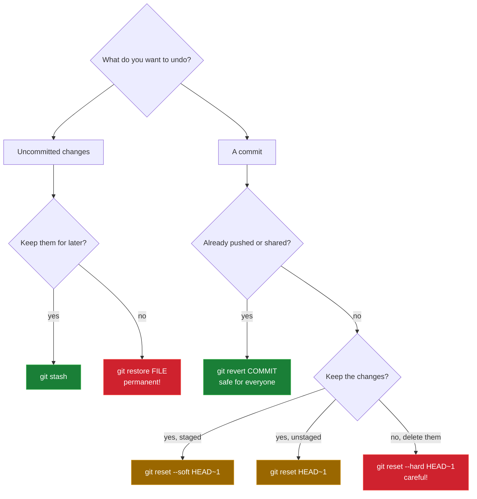

> [!IMPORTANT]
> **Rule of thumb:** `reset` is for *your* commits that only exist on *your* machine. `revert` is for everything that's already been pushed.

---

### 09 · Cherry-pick


`git cherry-pick` copies the change from **one specific commit** onto your current branch as a new commit. Perfect for taking a hotfix from a feature branch without dragging the unfinished work along.

**Branch** `skill/09-cherry-pick` · **File** `test-09.txt` · **Level** Intermediate · **Risk**  duplicates commits

**Try it**

```bash
git switch skill/09-cherry-pick
git log --oneline -4                 # experiment A, the fix, experiment B
git switch main
git cherry-pick -x skill/09-cherry-pick~1   # ~1 = one before the tip = the fix
cat test-09.txt                      # email fixed, and no experiments came along
git log -1                           # "(cherry picked from commit ...)"
```

You can of course use the hash from `git log` instead: `git cherry-pick -x <hash>`.

<details>
<summary><b>Check your result</b></summary>

- `test-09.txt` on `main` now says `support@example.com` and lists **no** experiments.
- The commit message ends with `(cherry picked from commit …)` thanks to `-x`.

</details>

> [!WARNING]
> - A cherry-pick creates a **duplicate**: same change, different hash. If the source branch is merged later, Git usually copes, but repeated picking back and forth leads to confusing conflicts. To bring over a whole branch, **merge** it instead.
> - Picking a commit that depends on earlier commits will conflict or produce broken code. Pick the dependencies too, oldest first.
> - Conflict? Resolve, `git add`, then `git cherry-pick --continue`, or `git cherry-pick --abort` to back out.

---

### 10 · Reflog


The reflog is Git's flight recorder: a **local** log of every position `HEAD` has pointed to. After a `reset --hard`, a botched rebase or a deleted branch, your commits still exist. The reflog tells you where they are.

**Branch** `skill/10-reflog` · **File** `test-10.txt` · **Level** Advanced · **Risk**  your rescue tool

**Try it**

```bash
git switch skill/10-reflog
git reset --hard HEAD~2              # chapters 2 and 3 are "gone"
git log --oneline -3

git reflog -5                        # HEAD@{1} = where you were before the reset
git reset --hard HEAD@{1}            # travel back
cat test-10.txt                      # all three chapters are back
```

**Bonus: rescue a deleted branch**

```bash
git switch main                      # HEAD@{1} is now the tip of skill/10-reflog
git branch -D skill/10-reflog        # oops
git reflog -3                        # the commit you were on is still listed
git switch -c rescued HEAD@{1}       # bring it back as a new branch
```

<details>
<summary><b>Check your result</b></summary>

- `git reflog` showed `HEAD@{0}: reset: moving to HEAD~2` at the top.
- After `git reset --hard HEAD@{1}`, `git log --oneline -3` lists chapter 3, 2 and 1 again.
- `rescued` points to the old tip of `skill/10-reflog` (chapter 3).

</details>

> [!IMPORTANT]
> - The reflog is **local only**: it isn't pushed, and a fresh clone starts with an empty one.
> - Entries **expire**: after 90 days by default, and after 30 days for commits no longer on any branch.
> - It only records **commits**. Uncommitted changes destroyed by `reset --hard`, `restore` or `clean` are gone for good. Commit early, commit often.

---

### 11 · Bisect


Something worked last week and is broken today, and there are dozens of commits in between. `git bisect` runs a **binary search** through history: you mark one commit *bad* and one *good*, Git checks out the commit in the middle, you test it and answer `good` or `bad`. Each answer halves the suspects, so 1,000 commits take about 10 tests.

**Branch** `skill/11-bisect` · **File** `test-11.txt` · **Level** Advanced · **Risk**  finish with `git bisect reset`

The story: somewhere in the last 8 commits, `tax_rate` changed from `0.20` to `2.0` (a 200% tax!). The commit messages won't tell you which one did it.

**Try it: by hand**

```bash
git switch skill/11-bisect
grep tax_rate test-11.txt            # tax_rate = 2.0  -> broken
git log --oneline -9                 # 8 suspects; none says "changed the tax rate"

git bisect start
git bisect bad                       # the current commit is broken
git bisect good HEAD~8               # 8 commits ago it was fine
# Git checks out a commit in the middle. Test it:
grep tax_rate test-11.txt
git bisect good                      # if it says 0.20
git bisect bad                       # if it says 2.0
# ...repeat until Git prints "<hash> is the first bad commit"

git bisect reset                     # IMPORTANT: return to your branch
```

**Try it: automatically**

```bash
git bisect start HEAD HEAD~8         # bad first, then good
git bisect run grep -q "tax_rate = 0.20" test-11.txt
git bisect reset
```

`git bisect run` uses the command's exit code: `0` means good, `1`–`127` (except `125`) means bad, and `125` means "can't test this one, skip it". Any test script or build command works.

<details>
<summary><b>Check your result</b></summary>

- It took **3** answers: commits *add support email* (good), *add newsletter opt-in* (bad) and *tweak price rounding* (bad).
- Git printed `<hash> is the first bad commit` for **`test-11: tweak price rounding`**, a harmless-sounding message hiding the bug.
- After `git bisect reset`, `git branch --show-current` prints `skill/11-bisect` again.

</details>

> [!WARNING]
> - During a bisect you're in **detached HEAD**: commits you make there belong to no branch and are easy to lose. Don't fix anything mid-bisect; note the culprit, `git bisect reset`, then fix it on a branch.
> - Always finish with `git bisect reset`, or you'll keep working on some random old commit.
> - One wrong `good`/`bad` answer sends the search to the wrong place. Not sure about a commit? Use `git bisect skip`. Check your answers with `git bisect log`.

---

## Danger zone

Commands that can **destroy work** or **hurt your teammates**, and how to protect yourself:

| Command | What can go wrong | Safety net / safer alternative |
|---|---|---|
| `git reset --hard` | Deletes all uncommitted changes forever | `git stash` first, or `git reset --keep`. Commits can be rescued with `git reflog` |
| `git push --force` | Overwrites the remote branch and can **delete teammates' commits** | `git push --force-with-lease` (refuses if the remote moved). Never force-push `main` |
| `git rebase`, `git commit --amend` on pushed commits | Rewrites shared history; everyone else's copy now conflicts | Only rewrite your own unshared branches. Use merge or revert on shared ones |
| `git restore <file>`, `git checkout -- <file>` | Discards uncommitted edits to that file, no undo | `git stash`, or check `git diff` first |
| `git clean -fd` | Permanently deletes untracked files (they were never in Git!) | Always preview with `git clean -n` first |
| `git stash drop`, `git stash clear` | Deletes stashed work, with no reflog to fall back on | `git stash show -p` before dropping; prefer `pop` |
| `git branch -D` | Deletes a branch even if its work is unmerged | Use `git branch -d`; recover with `git reflog` |
| `git cherry-pick` back and forth | Duplicate commits and confusing conflicts later | Merge whole branches; use `-x` to record origins |
| `git revert` of a merge commit | Re-merging that branch later won't bring the changes back | Plan to "revert the revert" if you merge again |
| Working in detached HEAD (bisect, `git switch --detach`) | New commits belong to no branch and get lost | `git switch -c <branch>` before committing; `git bisect reset` when done |

> [!CAUTION]
> Before **any** command in this table on a real project: run `git status`, make sure nothing important is uncommitted, and if in doubt create a backup branch first: `git branch backup/before-cleanup`. It costs nothing.

## Oh no! Recovery guide

| Oh no, I... | Do this | Shared-branch safe? |
|---|---|:-:|
| committed to the wrong branch (not pushed) | `git branch new-branch` → `git reset --keep HEAD~1` → `git switch new-branch` | local only |
| need to fix the last commit message (not pushed) | `git commit --amend -m "Better message"` | local only |
| forgot a file in the last commit (not pushed) | `git add the-file` → `git commit --amend --no-edit` | local only |
| staged something by accident | `git restore --staged <file>` | yes |
| want to discard my edits to a file | `git restore <file>` (permanent!) | yes |
| just did a merge or rebase that went wrong | `git reset --hard ORIG_HEAD` | local only |
| am stuck in the middle of a merge, rebase or cherry-pick | `git merge --abort` / `git rebase --abort` / `git cherry-pick --abort` | yes |
| ran `git reset --hard` and lost commits | `git reflog` → `git reset --hard HEAD@{n}` | local only |
| deleted a branch | `git reflog` → `git switch -c <name> <hash>` | yes |
| pushed a bad commit to a shared branch | `git revert <hash>` → `git push` | **yes** |
| need to switch branches but my work isn't ready | `git stash` → switch → `git stash pop` later | yes |
| forgot `git bisect reset` | `git bisect reset` (it's never too late) | yes |

## Cheat sheet

| Skill | Everyday commands |
|---|---|
| Inspect | `git status` · `git lg` · `git diff` · `git diff --staged` · `git show <hash>` |
| Branch & switch | `git switch -c <new>` · `git switch <branch>` · `git switch -` · `git branch -d <branch>` |
| Merge | `git merge <branch>` · `git merge --no-ff <branch>` · `git merge --ff-only <branch>` · `git merge --abort` |
| Conflicts | `git status` · edit the file · `git add <file>` · `git merge --continue` |
| Rebase | `git rebase main` · `git rebase --continue` · `git rebase --abort` · `git pull --rebase` |
| Interactive rebase | `git rebase -i HEAD~N` · `git commit --fixup <hash>` · `git rebase -i --autosquash main` |
| Stash | `git stash push -m "msg"` · `git stash list` · `git stash apply` · `git stash pop` · `git stash -u` |
| Reset | `git reset --soft HEAD~1` · `git reset HEAD~1` · `git reset --hard HEAD~1` · `git reset --keep HEAD~1` |
| Revert | `git revert <hash>` · `git revert --no-edit <hash>` · `git revert -m 1 <merge-hash>` |
| Cherry-pick | `git cherry-pick <hash>` · `git cherry-pick -x <hash>` · `git cherry-pick --continue` · `git cherry-pick --abort` |
| Reflog | `git reflog` · `git reset --hard HEAD@{n}` · `git switch -c rescued HEAD@{n}` |
| Bisect | `git bisect start` · `git bisect bad` · `git bisect good <ref>` · `git bisect run <cmd>` · `git bisect reset` |
| Remote | `git fetch` · `git pull --rebase` · `git push -u origin <branch>` · `git push --force-with-lease` |

## Golden rules

1. **Run `git status` before and after every command.** It tells you where you are and what Git expects next.
2. **Commit early, commit small.** Small commits are easy to review, move, revert and bisect. Only committed work can be rescued.
3. **Never rewrite shared history.** No `rebase`, `reset` or `--amend` on commits others have pulled. Use `revert`.
4. **Never `--force`, always `--force-with-lease`,** and only on your own branches.
5. **Make a backup branch before anything scary:** `git branch backup/<name>`.
6. **Don't panic.** Committed work is almost never lost for weeks: `git reflog`.

## Team workflow on GitHub

Everything above works locally after a simple clone. To practise the GitHub side (push, pull requests, reviews), work in your own copy:

1. **Fork** this repository. In the fork dialog, **untick "Copy the main branch only"** so you get all `skill/*` branches (or run `gh repo fork aimagician/git-testing --clone`, which copies every branch).
2. Create a branch: `git switch -c practice/<your-name>`.
3. Make small, focused commits to any `test-XX.txt`.
4. Stay up to date: `git fetch origin`, then `git rebase origin/main`.
5. Push: `git push -u origin practice/<your-name>`. After a rebase: `git push --force-with-lease`.
6. Open a **pull request**, ask a teammate to review, answer comments with new commits (or `--fixup` + autosquash).
7. Merge with **Squash and merge** for a tidy history, then delete the branch.
8. Broke something after merging? Use the **Revert** button on the merged pull request.

> [!IMPORTANT]
> Team members with write access to this repository: please **don't push to `main` or `skill/*`**. They are everyone's starting point. Use `practice/<your-name>/...` branches.

## Test yourself

<details>
<summary><b>1. You created <code>feature</code> from <code>main</code> and made two commits. Which branch moved?</b></summary>

Only `feature`. A new commit moves only the branch `HEAD` is on; `main` still points to the old commit.
</details>

<details>
<summary><b>2. When does <code>git merge</code> fast-forward?</b></summary>

When your branch has no commits the other branch lacks (it's an ancestor), so Git can simply move the label forward. No merge commit is created.
</details>

<details>
<summary><b>3. What sits between <code>&lt;&lt;&lt;&lt;&lt;&lt;&lt;</code>, <code>=======</code> and <code>&gt;&gt;&gt;&gt;&gt;&gt;&gt;</code>?</b></summary>

Your version (`HEAD`) above `=======`, the incoming branch's version below it. You write the final text and delete all three markers.
</details>

<details>
<summary><b>4. Why do you need <code>--force-with-lease</code> after rebasing a branch you already pushed?</b></summary>

Rebase creates new commits, so the remote still has the old ones and a normal push is rejected. `--force-with-lease` overwrites it only if nobody else pushed in the meantime.
</details>

<details>
<summary><b>5. <code>squash</code> vs. <code>fixup</code> in an interactive rebase?</b></summary>

Both melt a commit into the one above it. `squash` lets you combine and edit the messages; `fixup` throws the fixup's message away.
</details>

<details>
<summary><b>6. <code>git stash apply</code> vs. <code>git stash pop</code>?</b></summary>

Both bring the changes back. `apply` keeps the stash entry; `pop` deletes it (unless there's a conflict, in which case the entry is kept).
</details>

<details>
<summary><b>7. Which reset mode keeps your changes staged, and which one deletes them?</b></summary>

`--soft` keeps them staged. `--hard` deletes them. `--mixed` (the default) keeps them unstaged.
</details>

<details>
<summary><b>8. A bad commit is already on the shared <code>main</code>. Reset or revert?</b></summary>

`git revert`. It adds a new commit, so nobody's history breaks and a normal push works.
</details>

<details>
<summary><b>9. Does <code>git cherry-pick</code> move the original commit?</b></summary>

No. It copies the change as a new commit with a new hash; the original stays on its branch.
</details>

<details>
<summary><b>10. You ran <code>git reset --hard HEAD~3</code> by mistake. How do you get the commits back?</b></summary>

`git reflog` to find where you were (usually `HEAD@{1}`), then `git reset --hard HEAD@{1}`.
</details>

<details>
<summary><b>11. Roughly how many tests does <code>git bisect</code> need for 1,000 commits, and what must you never forget?</b></summary>

About 10 (log₂ 1000 ≈ 10). And always finish with `git bisect reset`.
</details>

## Contributing

Spotted a mistake, or have an idea for skill #12? Open an issue or a pull request. Please keep practice files as plain `.txt`, and keep `main` and `skill/*` exactly as described in [How the lab works](#how-the-lab-works).

---

<div align="center">

Built for my team, and for anyone who wants to get really good at Git.<br>
<sub>Maintained by <a href="https://github.com/aimagician">@aimagician</a> · Animations are plain SVG + CSS, no JavaScript</sub>

</div>
